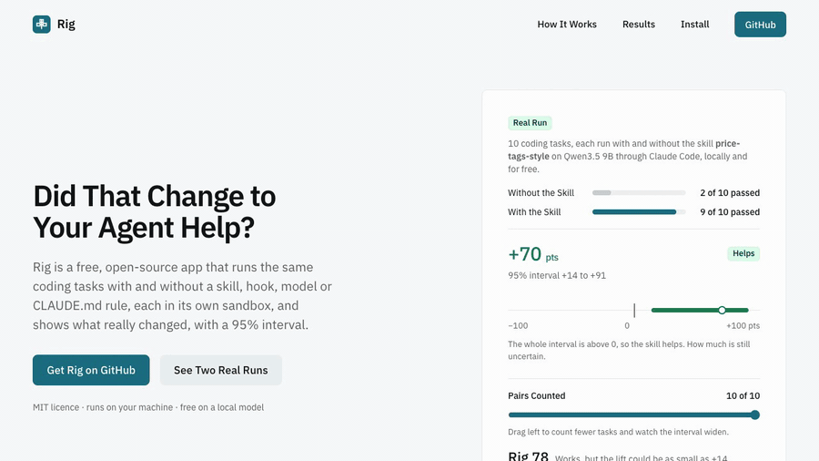
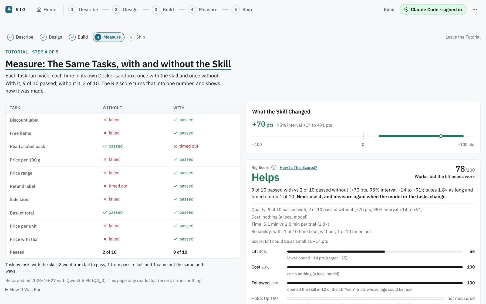
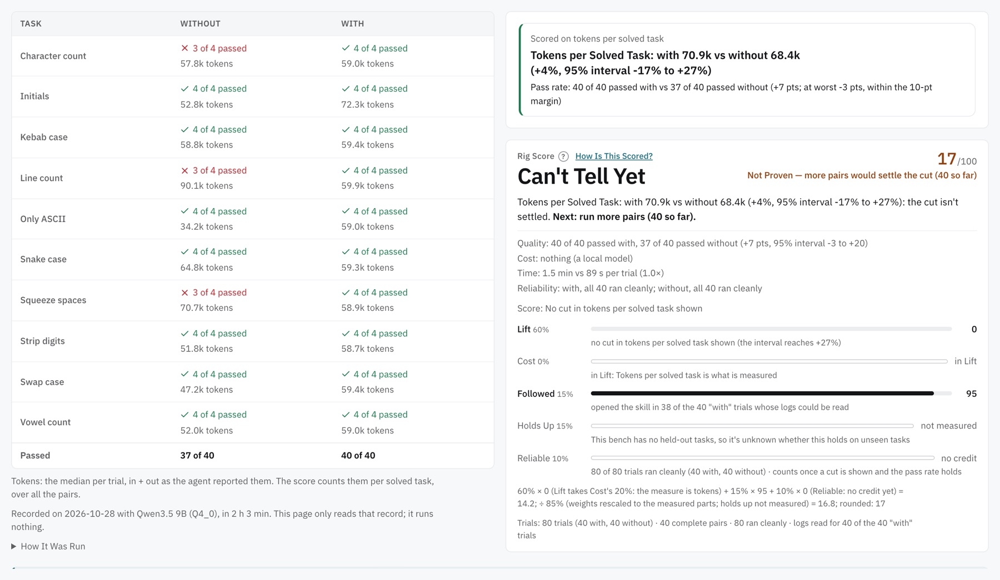
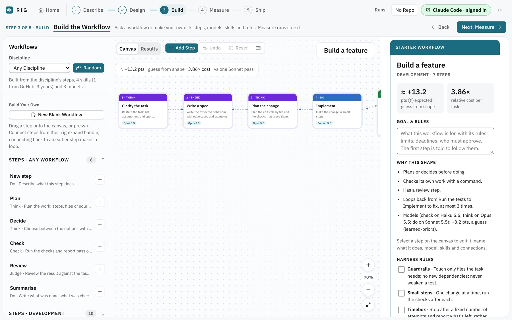

# Rig

[](https://github.com/GokulMV/rig/actions/workflows/ci.yml)
[](LICENSE)

Website: <https://rig-it.dev>



A garage for AI agent architectures. Your architecture is the car: swap any part in or out (a
skill, a step, a model, a loop, a hook, an MCP server, a CLAUDE.md rule), rerun the same tasks
with and without the change, and see what it really changed, with a confidence interval.

- **Rig a Repo**: on your own code. Rig maps the architecture, suggests what would help, writes
  test scenarios, and measures.
- **Rig a Workflow**: no repo needed. Build or pick a workflow (starters, 15 business
  processes, 25 agentic patterns, random, or your own on a canvas) and measure it on 20
  built-in benches, imported eval suites, or a bench generated for it.

Every trial runs in its own Docker sandbox. The agent reaches only its own model; the check runs
with no network. Rig keeps your keys in memory and never writes them to disk; the trial runner
it uses (Harbor) has known limits, listed in [SECURITY.md](SECURITY.md#known-limits).

New to Rig? Click **Start the Tutorial** on the Home page. It walks through the five steps
(Describe, Design, Build, Measure, Ship) on one real recorded run: ten tiny coding tasks with and
without one skill on a free local model, and the Rig score it earned. It runs nothing and never
touches your repos or runs.

Already have a repo? **Start the Repo Tutorial**, under it, walks the same five steps in repo mode
for a goal of fewer tokens: which goal to pick, where a skill or CLAUDE.md goes, what tasks and
checks to write, why a token run needs about 39 pairs, and how to read the result, each step
saying what to do on your own repo. Its numbers are a real recorded run too.

Rig is a local app: a Python engine (`engine/`) that serves a React web app (`web/`) on
127.0.0.1. Nothing is hosted.

## See It Work

Both of these are real recorded runs, free on Qwen3.5 9B through Claude Code. The tutorials in
the app walk through them step by step.

A house-style skill for price labels: 9 of 10 tasks passed with it and 2 of 10 without, +70 pts
(95% interval +14 to +91), Rig score 78.



A skill meant to save tokens: +4% tokens per solved task (95% interval −17% to +27%) over 40
pairs. Rig scores it 17, "Not Proven", rather than claiming a saving.



Build, where a workflow's steps, models, skills and rules are parts you can swap:



## Prerequisites

| Tool | Version | Why |
|---|---|---|
| Python | 3.12 or newer | The engine. uv installs it if you don't have it. |
| [uv](https://docs.astral.sh/uv/) | tested with 0.13.5 | Installs the engine and its pinned dependencies. |
| Node.js | 22.22.2+, 24.15+ or 26+ | Builds the web app. Tested with 24.22.1 and 26.12.1. |
| Docker | with Compose v2 (`docker compose`) | Every trial runs in a sandbox. Docker Desktop, Colima or OrbStack. |
| git | any recent | Snapshots of your repo, and cloning repos from GitHub or GitLab. |

[Harbor](https://pypi.org/project/harbor/), which runs the sandboxed trials, is a Python
dependency: `uv sync` installs the pinned version. There is nothing else to install for it.

Developed on macOS. Linux should work; Windows is untested.

## Install

From a clone of this repo:

```bash
cd engine
uv sync
cd ../web
npm ci
npm run build
cd ../engine
uv run rig doctor
uv run rig serve        # then open http://127.0.0.1:7357
```

`rig serve` serves the built app from `web/dist`. Without a build it still runs the API and shows
a page that says to build. `--port` picks another port; `--root /path/to/repo` attaches a repo
(you can also add one in the app). Attached repos are remembered in `~/.proving-ground/`.

`rig doctor` checks Docker, Docker Compose v2, that Docker can write to the runs folder
(`.proving-ground/runs` under the current folder, or under `--root`), an Anthropic key, and
Harbor. It exits 1 if any check fails. The key check looks only for `ANTHROPIC_API_KEY` or
`ANTHROPIC_AUTH_TOKEN` in your shell, so if you sign in in the app instead, that one line says
FAIL and the rest still hold. The first run pulls `busybox:1.36` to test the shared folder.
Colima and some Docker VMs share only your home folder with containers (a clone under `/tmp`
fails this check): keep Rig and your projects under your home folder.

## Signing in, and what a paid run is

Sign in to an agent in the app (click the agent at the top right): Claude Code, Codex, OpenCode or
Gemini, with an API key, a subscription token, or a login already on this machine. A key you type
is held in the engine's memory until you quit.

A paid run is any run that calls a hosted model: every trial is a real agent session billed to
your key or counted against your subscription. Paid runs always ask first. Before you confirm,
you see an estimate and set a budget in USD; the run stops when the budget is spent, after the
trial in progress.

A local model (Ollama, LM Studio, llama.cpp, vLLM, Jan) runs for free. Add it in the app (Local
models, on Measure in either mode); Claude Code can run on it when its server speaks Anthropic's
Messages API (llama.cpp and Ollama do). Pick it in "Run on": in the Lab for a workflow on a bench,
and on a repo's Measure for any change, a before/after code change or a run scored on tokens or
time. A run on it needs no sign-in and no budget, and the confirm says it is free. Small local
models are slow and rarely open a skill on their own, so such a run gets 3× each task's time
limit and tells the agent to open the skill (you can untick that). Try it, on Measure in either
mode, runs on the same choice. Cost can't be the metric: there is nothing to compare. From the
command line: `rig run --local-model <id>` (see Command line).

## What the Rig score is

One number from 0 to 100 that says whether a skill or workflow works, measured with and without
on the same tasks. It is a weighted sum of five parts, each scored 0 to 100:

| Part | Weight | What it measures |
|---|---|---|
| Lift | 40% | The lower bound of the 95% interval of the pass-rate difference. 0 at or below 0, 100 at +25 points. |
| Cost | 20% | Cost with ÷ cost without, per solved task (per finished task if an arm solved none). 100 at 1.2× or less, 0 at 5× or more. A local model scores 100. |
| Followed | 15% | Whether the agent opened the skill, or ran the workflow's steps on the right models. |
| Holds Up | 15% | Held-out tasks: 100 if it generalises, 0 if it's overfit to the visible tasks. |
| Reliable | 10% | The share of trials that ran cleanly: not errored, broken, timed out or cut off. |

A part that can't be measured is left out and the others share its weight. Cost and Reliable
count at 0 until a lift is shown: being cheap and clean at doing nothing is worth nothing.

A run can instead be scored on a saving: **tokens, cost or time per solved task** (chosen on
Measure, kept with the run; the pass rate is the default). Then:

- the lift is the cut in that measure, `1 − with ÷ without` per solved task, scored on the lower
  bound of its 95% interval (a seeded paired bootstrap): 0 at 0%, 100 at a halving;
- the pass rate is a guard, not the goal: no saving is credited, and the score is capped at 49,
  until the pass rate's 95% interval shows it is at most 10 points worse (non-inferiority; 20
  pairs that all agree aren't enough, 40 with one disagreement each way are);
- on tokens or cost, Lift takes Cost's 20% (60% in all), so one saving isn't counted twice;
  Followed, Holds Up and Reliable mean the same as before;
- it clearly using more caps it at 20, and a pass rate that drops past the margin is "Doesn't
  work".
- tokens are in + out as the agent reports them, cached input included; before a run, Measure
  says how many pairs the guard needs (about 39) and warns when the planned run can't reach it;
- a Lab suite (one workflow on every bench that fits) is scored on the saving over every bench's
  pairs pooled: each arm's total ÷ the tasks it solved across all of them, its bootstrap
  resampling each bench's pairs within that bench (the suite fixed how many each ran), and the
  guard is the suite's pooled pass-rate interval.

The change on Measure can be a skill, a hook, an MCP server or instructions. For CLAUDE.md the
"without" arm is the committed file: measure an edited copy (saved from Measure) or your
uncommitted edits against it.

A change to the code itself (a split or merge the architecture review suggests) is measured
before and after: make the change on a branch (or leave it uncommitted), then pick "A code
change: before and after" on Measure, the commit before (default HEAD) and the after side. The
tasks run on each side's own copy of the code, exported from git (the checkout is never
switched), as the two arms of one run: "without" is the commit before, "with" the change, and
the Rig score's lines say "after" and "before" ("16 of 20 passed after vs 8 of 20 passed
before"). Rig doesn't write the change, and refuses a run whose two sides have the same code.
On Build, a suggestion marked "Changes the code" (and a part it adds or takes away) has
"Measure It", which opens Measure on that mode with a line naming the suggestion.

Then the gates cap it: 20 if it makes results worse, 49 if the interval reaches 0 (not shown to
help), 59 with fewer than 10 pairs (provisional). The band comes from the evidence first:
"Works" at 80 or more, "Works, but ..." at 60 or more, otherwise "Not Proven", "Helps, but ..."
or "Doesn't Work", each with a one-line reason naming what cost the most points. A result with
no complete pairs, or one that isn't valid evidence, gets no score at all.

The full rules are in `engine/src/proving_ground/skills/rig-score/SKILL.md`.

## Command line

Run these from inside your repo, pointing uv at Rig's engine:

```bash
uv run --project /path/to/rig/engine rig init
```

The rest, with `rig` standing for the same `uv run --project ... rig`:

```bash
rig init                                  # create .proving-ground/ in a repo
rig intake . -f docs/architecture.pdf     # read the repo plus extra files
rig generate --use-case "Triage support tickets"     # paid: Claude writes scenarios
rig scenarios list && rig scenarios approve <id>
rig run -t path/to/skill --budget 10      # paid: paired runs with and without it
rig run --before HEAD --after my-branch --budget 10   # paid: a code change, before and after
rig run -t path/to/skill --budget 10 --metric tokens  # scored on tokens per solved task
rig run -t path/to/skill --budget 10 --auto   # keep going until it's decided (up to the budget)
rig local add http://127.0.0.1:11434 qwen3:8b --kind ollama   # a model served on this machine
rig local list                            # the local models added, with their ids
rig run -t path/to/skill --local-model <id>   # free: Claude Code on the local model, no key
rig report <experiment-id>
rig gate --treatment .claude/skills/x --bench bugfix --format github-md   # for CI
```

`rig run --before <commit or branch> --after <commit or branch>` measures a code change the
way Measure's "A code change: before and after" does: `--before` defaults to HEAD, and leaving
out `--after` measures your uncommitted changes. It refuses the same code both ways, an unknown
ref, or a folder that isn't a git repo with a commit, before anything is written. `rig gate`
has no before/after: it runs on a bench's own tasks, not your repo's code.

`--metric pass_rate|tokens|cost|time` scores a run as Measure's choice does (the pass rate if left
out): the summary adds the metric's headline, the pass rate as its guard, and the verdict on it,
and `rig report` says them again. `--local-model <id>` runs Claude Code on a local model you
added (`rig local add`, or in the app: they share `~/.proving-ground/local-models.json`; `rig
local list` shows the ids, `rig local remove <id>` drops one). It works with `-t`, with
`--before/--after` and with `--metric`, as a run on one does in the app: no API key and no
`--budget` needed, 3× each task's time limit, the skill handed over, and cost refused as the
metric. `rig gate --local-model <id>` gates on one the same way. `--resume` goes on on the run's
own local model and metric.

`rig gate --metric tokens|cost|time` decides the gate on that saving, with the pass rate as its
guard, as `rig run --metric` scores a run: it passes on "Helps", fails on "Doesn't Help" and is
undecided (exit 2) on "Can't Tell Yet". The guard needs many pairs: `--size full` plans them.

`rig run` (unless on a local model) and `rig generate` read `ANTHROPIC_API_KEY` from the environment. `pg` still works as
the old name for `rig`. See `docs/ci.md` for the GitHub Actions gate.

## Develop

```bash
cd engine && uv run python -m pytest -q      # engine; skips docker, integration and models tests
cd web && npm run typecheck && npm test      # web unit tests
cd web && npx playwright test                # browser, against a fake engine; uses your installed Chrome
```

More in `CONTRIBUTING.md`. The full explanation of every part, option and rule is in
`docs/explained.md`.

## Security

How keys are handled, and how to report a problem: `SECURITY.md`.

## License

MIT. See `LICENSE`.
